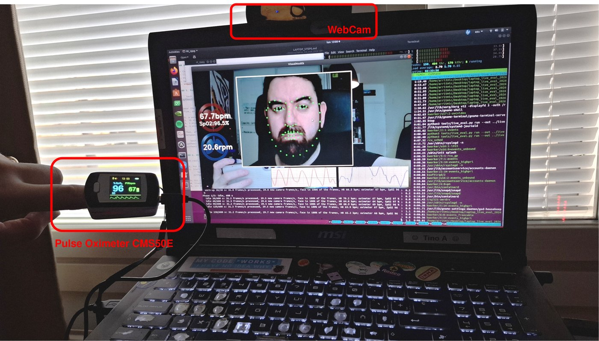
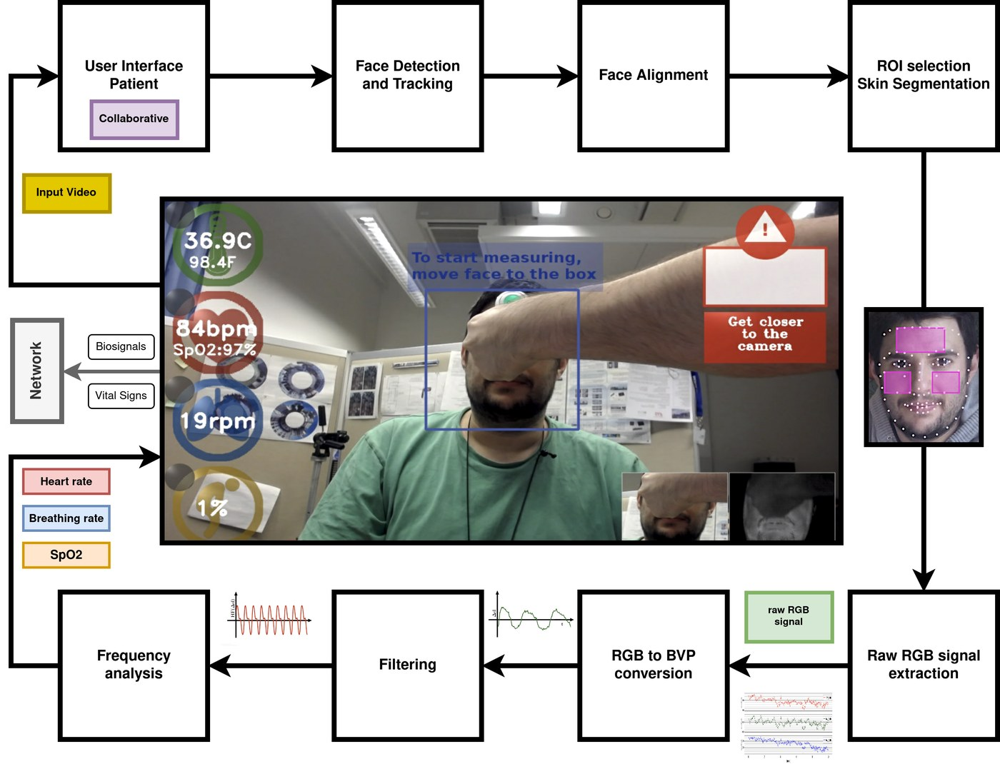
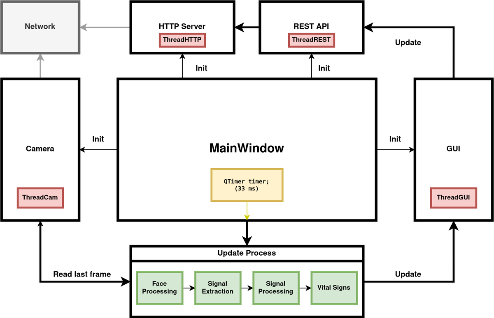
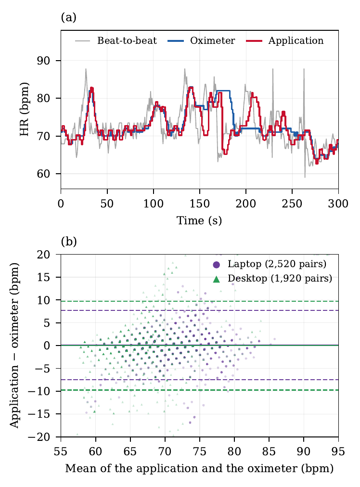

# rt-rppg: real-time vital signs from a webcam

**Contactless monitoring of heart rate, respiratory rate and SpO2 in C++: real time on a laptop CPU, with an ordinary webcam, and with a REST API and live video streams for other applications.**



rt-rppg is a real-time remote photoplethysmography (rPPG) application in C++. It estimates the heart rate (HR) from the face in a webcam video stream, using the Face2PPG pipeline adapted to real-time operation, and shows the result in a Qt graphical user interface. The application also computes the respiratory rate (RR) and an uncalibrated estimate of the oxygen saturation (SpO2); these two outputs are experimental and have only been evaluated in a preliminary way (see the paper).

This is the source code of the real-time application described in:

> C. Álvarez Casado, S. Sharifipour, M. Lage Cañellas, N. Nguyen, L. Nguyen and M. Bordallo López, "Design, Implementation and Evaluation of a Real-Time Remote Photoplethysmography (rPPG) Acquisition System for Non-Invasive Vital Sign Monitoring", *Multimedia Tools and Applications* (under review). Preprint: [arXiv:2508.18787](https://arxiv.org/abs/2508.18787).

## Citation

If you use this code in your work, please cite the paper (see also `CITATION.cff`):

```bibtex
@article{AlvarezCasado2025RealTimeRPPG,
  title   = {Design, Implementation and Evaluation of a Real-Time Remote Photoplethysmography ({rPPG}) Acquisition System for Non-Invasive Vital Sign Monitoring},
  author  = {{\'A}lvarez Casado, Constantino and Sharifipour, Sasan and Lage Ca{\~n}ellas, Manuel and Nguyen, Nhi and Nguyen, Le and Bordallo L{\'o}pez, Miguel},
  journal = {arXiv preprint arXiv:2508.18787},
  year    = {2025},
  doi     = {10.48550/arXiv.2508.18787}
}
```

## Authors

The application was designed and developed by Constantino Álvarez Casado and Miguel Bordallo López (Center for Machine Vision and Signal Analysis, University of Oulu).

The code is essentially the original application, written in 2017. For this release, some libraries were changed and minor issues were fixed with the support of Claude Opus 5.5 (Anthropic), and the network module and the evaluation tools listed in [Notes](#notes) were added.

## Processing pipeline

- Face detection with YuNet (OpenCV), every three frames.
- Face alignment with an Ensemble of Regression Trees model (dlib, 68 landmarks), stabilized with an alpha-beta filter (see [Facial landmark model](#facial-landmark-model)).
- Geometric face normalization with a mesh of 122 triangles.
- rPPG signal from the a* channel (CIE-Lab) of the central facial region.
- 61-tap FIR band-pass filter (0.7–2.5 Hz).
- HR from the FFT of the filtered signal (Hann window, zero-padding), updated every 30 samples.
- RR from the L* channel (8–42 breaths per minute) and SpO2 from the red and green channels: ratio of ratios, with the AC components taken from the values band-pass filtered at 0.75–1.75 Hz and the DC components from the unfiltered values (fixed, uncalibrated constants).
- RESTful API and MJPEG video streams for other applications (see [Network interface](#network-interface)).



*Architecture of the application (Figure 1 of the paper).*



*Implementation design (Figure 2 of the paper): the main window triggers the processing of the latest camera frame every 33 ms, and the camera, the GUI and the network servers run in their own threads.*

## Requirements

The original application was developed with Qt 5.13, OpenCV 4.5.5 and dlib 19.23. The CMake build was tested on Ubuntu 24.04 with the packages of the distribution (Qt 5.15.13, OpenCV 4.6.0, dlib 19.24):

```bash
sudo apt install build-essential cmake qtbase5-dev libopencv-dev libdlib-dev
```

OpenCV must be version 4.5.4 or newer, with the `dnn` and `objdetect` modules (YuNet face detector).

## Build

```bash
cmake -S . -B build
cmake --build build -j
```

The configuration step decompresses the facial landmark model and copies `models/`, `images/` and `log.conf` next to the executable.

Without CMake 3.16, the qmake project builds the same application, with OpenCV and dlib from pkg-config or from the folders where they were built:

```bash
qmake OPENCV_DIR=/path/to/opencv DLIB_DIR=/path/to/dlib   # or just: qmake
make -j4
bunzip2 -kc models/shape_predictor_68_face_landmarks_GTX.dat.bz2 > models/shape_predictor_68_face_landmarks_gtx.dat
./rt_rppg
```

The qmake build writes `rt_rppg` next to `rt-rppg.pro`, so it is started from the source folder.

## Run

```bash
cd build
./rt_rppg
```

- A webcam is required. The application requests 1280×720 MJPG images at 30 fps (through V4L2 on Linux) and processes the central 480×360 region. If the camera delivers another size, the frames are scaled to a height of 720 pixels and centred in a 1280×720 frame.
- In low light, many webcams lower their frame rate to lengthen the exposure. Good, even lighting of the face keeps the camera at 30 fps. Alternatively, a fixed exposure keeps 30 fps: `RT_RPPG_EXPOSURE=330 RT_RPPG_GAIN=128 ./rt_rppg` sets the exposure (in the units of the camera driver; with V4L2, 100-µs steps, so 330 = 33 ms) and the gain after the first frames, and restores the automatic exposure when the application closes. The gain that gives a correct brightness depends on the camera and the light; a higher gain adds noise to the signal.
- Sit still in front of the camera, with the face inside the central rectangle. HR, RR and SpO2 are shown after a few seconds and are written to `/var/tmp/vidhealth.csv` (see `log.conf`).
- Press any key to close the application. Ctrl+C or `SIGTERM` close it in the same way.
- The processing thread requests real-time scheduling (`SCHED_FIFO`); without the required permissions it prints a message and continues with the normal priority.
- All the processing runs on the CPU. The face detector (YuNet, DNN module of OpenCV) can optionally run on a GPU: `RT_RPPG_DNN=opencl` (or `opencl_fp16`) uses OpenCL, and `RT_RPPG_DNN=cuda` (or `cuda_fp16`) the CUDA backend, which needs OpenCV built with CUDA and the fp32 model (`RT_RPPG_FACE_MODEL=/path/to/face_detection_yunet_2022mar.onnx`, from the [OpenCV Zoo](https://github.com/opencv/opencv_zoo/tree/main/models/face_detection_yunet)). For a model of this size, a GPU is not necessarily faster: in a short test on the desktop computer of the paper, the face detection took 0.19 ms per frame on the CPU and 1.1 ms with OpenCL on its GPU. The measurements of the paper use the CPU.
- Without a camera, a video file can be used instead: `RT_RPPG_VIDEO=/path/to/video.avi ./rt_rppg`. The frames are delivered at the frame rate of the file, scaled to a height of 720 pixels and centred in a 1280×720 frame, and the video starts again when it ends (with `RT_RPPG_VIDEO_LOOP=0`, the application closes at the end of the video instead). This option is intended for tests and pre-recorded videos; with a 30 fps video, the timing is close to that of a camera.

## Public datasets as pre-recorded input

`tools/run_datasets.py` runs the application on the videos of the public datasets used in the paper (COHFACE, UBFC-RPPG and LGI-PPGI), which must be obtained from their authors. Each video replaces the camera and is played once, in real time, with the timing log and without the network interface. For each video, the script writes the HR, RR and SpO2 shown by the application once per second of video, next to the reference HR of the dataset, and a summary with the MAE of the HR:

```bash
python3 tools/run_datasets.py ubfc2 /path/to/UBFC-RPPG/DATASET_2 --out dataset_runs/ubfc2
python3 tools/run_datasets.py ubfc1 /path/to/UBFC-RPPG/DATASET_1
python3 tools/run_datasets.py lgi-ppgi /path/to/LGI-PPGI
python3 tools/run_datasets.py cohface /path/to/cohface     # reference HR from data.hdf5: needs numpy, and h5py or PyTables
```

- The application runs without a window (`QT_QPA_PLATFORM=offscreen`); `--show` shows it. `--max-videos N` and `--seconds S` limit the run for tests, and the videos already processed are skipped when the command is run again (`--redo` processes them again).
- As with a camera, the application processes the central 480×360 region of the 1280×720 frames, so the face must be in the central part of the video.
- The HR of the application is computed from the last 10 s of signal and follows the changes of HR with a delay of a few seconds. These results are therefore not those of the accuracy evaluation of the paper (Table 2), which was performed offline with a Python implementation of the processing chain and the evaluation protocol described in the paper.

## Network interface

Two HTTP servers start with the application, each in its own thread (`src/network.cpp`, POSIX sockets, no extra libraries). The processing loop only stores the latest values and images; the clients are served in the network threads.

| URL | Content |
|---|---|
| `http://127.0.0.1:8080/vhealth` | Latest values as text, with the format `%05.1f,%05.1f,%05.1f,%d,%d,%08.1f,%08.1f`: HR, RR, SpO2, user present, stable, and the latest samples of the pulse and breathing signals |
| `http://127.0.0.1:8080/vhealth.json` | The same values as JSON |
| `http://127.0.0.1:8081/` | Web page with both video streams and the latest values |
| `http://127.0.0.1:8081/mainstream` | MJPEG stream of the camera image |
| `http://127.0.0.1:8081/pulsestream` | MJPEG stream of the normalized, magnified face |

```bash
$ curl http://127.0.0.1:8080/vhealth
072.5,014.0,097.9,1,1,-00012.3,000003.2
$ curl http://127.0.0.1:8080/vhealth.json
{"hr":72.5,"rr":14.0,"spo2":97.9,"user_present":1,"stable":1,"hr_signal":-12.3,"rr_signal":3.2,"timestamp_ms":1792249011839}
```

- The values are those shown in the GUI. Discard them while `stable` is 0 (the signal buffers are still filling) or `user_present` is 0 (no face).
- The JPEG images are only encoded while a client watches a stream.
- By default the servers only accept connections from the same computer. The streams show the face of the user and there is no authentication or encryption, so accept other devices only in a trusted network.

Settings (environment variables):

| Variable | Default | Meaning |
|---|---|---|
| `RT_RPPG_NETWORK` | `1` | `0` disables both servers |
| `RT_RPPG_BIND` | `127.0.0.1` | IPv4 address to listen on; `0.0.0.0` accepts other devices |
| `RT_RPPG_REST_PORT` | `8080` | Port of the RESTful API; `0` disables it |
| `RT_RPPG_STREAM_PORT` | `8081` | Port of the streaming server; `0` disables it |

For example, `RT_RPPG_BIND=0.0.0.0 RT_RPPG_REST_PORT=9090 ./rt_rppg`.

## Timing log and live evaluation

With `RT_RPPG_TIMING=<folder>`, the application writes two CSV files in that folder (see `src/timinglog.h`):

- `camera.csv`, one row per captured frame: frame number, time of the frame in the camera driver (V4L2 buffer timestamp; -1 with other backends and with video files) and time at which the decoded frame is available;
- `frames.csv`, one row per iteration of the processing loop: iteration number, camera frame used and its times, times at the start of the iteration and after reading the frame, the processing, the GUI image and the network step (values and JPEG images), face and stability flags, HR, RR and SpO2, and the encoding time and size of the JPEG image of each stream.

The times are microseconds of the monotonic clock (`CLOCK_MONOTONIC`), which is also the clock of the V4L2 timestamps, so they can be compared with the times recorded by other programs on the same computer. Each JPEG image of the streams carries the iteration number in an `X-Frame` header, and the threads are named (`rt-camera`, `rt-net-*`), so that their CPU use can be read from `/proc`.

`tools/live_eval.py` (Python 3.5 or newer, standard library only) runs the application with the timing log through a sequence of load phases: no network clients, API requests at 10 Hz, and 1, 4 and 8 stream clients on the same computer. It samples the CPU, memory and temperature every second and summarizes, for each phase, the frame rates, repeated and lost frames, the loop and latency distributions, the JPEG encoding, the API latency, and the throughput and latency of the streams:

```bash
python3 tools/live_eval.py run --env RT_RPPG_EXPOSURE=330 --env RT_RPPG_GAIN=128   # about 23 minutes
python3 tools/live_eval.py summary live_runs/<run>
```

The phases and their durations are set with `--phases` (default `idle:600,api:180,stream1:180,stream4:180,stream8:180`, after a warm-up of 30 s). The latency is measured from the time of the frame in the camera driver, so it does not include the exposure and the processing inside the camera, nor the refresh of the screen.

If a Contec CMS50E pulse oximeter with USB HID interface (USB ID `28e9:028a`) is connected, `live_eval.py` also records its pulse rate and SpO2 (once per second) and its pulse wave (60 samples per second) on the same clock (`tools/cms50e.py`). The summary then compares each oximeter value with the HR and SpO2 shown by the application at that time. On Linux, the oximeter needs no driver, only access to its `/dev/hidrawN` device, for example with the udev rule `SUBSYSTEM=="hidraw", ATTRS{idVendor}=="28e9", ATTRS{idProduct}=="028a", MODE="0666"` in `/etc/udev/rules.d/`. `python3 tools/cms50e.py` alone prints its values every second.

The measurements of the live evaluation reported in the paper (Section 5.3.5, Table 6 and Figure 4), on the laptop of the processing times and on a desktop computer, without images or video, are in [`data/live_evaluation`](data/live_evaluation), with the scripts that reproduce the table, the agreement with the oximeter and the figure.



*HR of the application against a fingertip pulse oximeter during live operation (Figure 4 of the paper): (a) 300 s of a session on the laptop, with the beat-to-beat pulse rate obtained from the pulse wave of the oximeter; (b) Bland-Altman plot of the five sessions on the laptop and the desktop computer.*

## Facial landmark model

The facial landmark model `models/shape_predictor_68_face_landmarks_GTX.dat.bz2` (ERT-GTX) was trained by the authors, as described in C. Álvarez Casado and M. Bordallo López, "Real-time face alignment: evaluation methods, training strategies and implementation optimization", *Journal of Real-Time Image Processing*, 2021. Its training data include the iBUG 300-W dataset, whose license excludes commercial use, so this model cannot be used in commercial products. It can be replaced by any other 68-point model in the dlib shape predictor format, for example one trained on data that allow commercial use: the file is loaded in `src/process.cpp` (`dlib::deserialize`). The sources, references and license notes of the two models (YuNet and ERT-GTX) are in [`models/README.md`](models/README.md).

## Notes

- Only the HR estimation has been quantitatively validated; RR and SpO2 have only been evaluated in a preliminary way (see the paper). The RR and SpO2 values are experimental outputs.
- Differences from the version used for the processing times reported in the paper (the core processing modules are the same):
  - the network interface is implemented in `src/network.cpp` (see [Network interface](#network-interface)) instead of the Restbed library and the previous HTTP server code;
  - the SpO2 computation takes the AC components from the band-pass filtered red and green values (two 61-tap filters per frame), as described in the paper;
  - the camera is opened through V4L2 on Linux and asked for 1280×720 images, other frame sizes are scaled to 1280×720, and the application exits with a message if the camera cannot be opened;
  - optional fixed exposure and gain (`RT_RPPG_EXPOSURE`, `RT_RPPG_GAIN`), and Ctrl+C or `SIGTERM` close the application as a key press does;
  - optional GPU for the face detector (`RT_RPPG_DNN`, `RT_RPPG_FACE_MODEL`);
  - a video file can replace the camera (`RT_RPPG_VIDEO`, `RT_RPPG_VIDEO_LOOP`), and `tools/run_datasets.py` runs the application on the videos of the public datasets;
  - optional timing log (`RT_RPPG_TIMING`), `X-Frame` header in the streams and named threads, for the live evaluation (`tools/live_eval.py`);
  - CMake build and qmake project without Restbed, and two unused dlib GUI headers removed (the dlib package of Ubuntu is built without GUI support);
  - the debug messages of the original code are commented out, except the processing times of the modules (`Times at frame`), and the windows are titled Face2PPG-RT.

## License

The code of this repository is licensed under the [PolyForm Noncommercial License 1.0.0](https://polyformproject.org/licenses/noncommercial/1.0.0) (see `LICENSE`). It can be used, modified and shared for any noncommercial purpose, such as research, teaching and personal study, including by educational institutions, public research organizations and other noncommercial organizations, keeping the `Required Notice` line of `LICENSE`. Commercial use requires a commercial license from the University of Oulu and the authors: contact Constantino Álvarez Casado (constantino.alvarezcasado@oulu.fi) or Miguel Bordallo López (miguel.bordallo@oulu.fi).

Attribution: copies of this code, or of any part of it, including software that contains it or is derived from it, must include the `Required Notice` lines of `LICENSE`, which credit the authors and the paper; the commercial licenses require the same attribution. If you use this code in your work, please cite the paper (see [Citation](#citation)). We encourage sharing improvements and derived works, for example through pull requests.

Some files include third-party code under their own licenses, and the facial landmark model cannot be used in commercial products; see `THIRD_PARTY_NOTICES.md` and [Facial landmark model](#facial-landmark-model).
